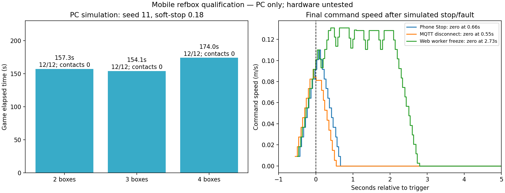

# Mobile practice refbox — ผลทดสอบ PC วันที่ 2026-10-22

ฟีเจอร์พร้อมสำหรับขออนุญาตนำไปทดสอบบนหุ่นแบบควบคุม ยังไม่ SSH/push/ติดตั้ง/restart หุ่น
Branch `proposal/mobile-refbox`; implementation `898de91`, UI correction `42cbd7e`.

## สิ่งที่ทำ

- หน้า Game เลือก Practice / Field refbox, 2/3/4 กล่อง, เวลาเกม, countdown และ seed ได้จากโทรศัพท์
- สร้าง/แก้ไข/บันทึก/โหลดสนาม พร้อมลูกศรทิศกล่อง 20×20 cm และรายการ 12 เป้า
- Generate/Load ไม่เริ่มเกมเอง ต้องยืนยันการจัดสนามแล้วกด Start; มี Stop และประวัติที่บันทึกบนดิสก์
- Practice ใช้ MQTT loopback บนเครื่องหุ่น ไม่ต้องมี PC refbox ในการใช้งานปกติ; โหมด Field คง broker สนามเดิม
- ตรวจ Robot/Navigation/LiDAR/pose/STOP ก่อนเริ่มและระหว่างเกม; ตั้ง pose ที่ C_Z51 หัน C_Z41 ก่อนเริ่ม
- เปลี่ยนสนามแต่ละรอบสร้าง task ใหม่; restart/ขาด MQTT ไม่กลับมาเคลื่อนที่อัตโนมัติ
- watchdog opt-in เฉพาะ practice: heartbeat timeout 2 s แล้ว cancel navigation และล็อกจนเริ่ม task ใหม่
- รักษา navigation soft-stop 0.18 และ collision_monitor เดิม; ไม่แก้ PolygonStop 0.29 หรือเครื่องหมายมอเตอร์

## วิธีใช้บนโทรศัพท์หลังได้รับอนุญาตลงหุ่น

1. Launch Robot และ Navigation soft-stop ตามเดิม
2. Game → Practice on this robot → Use selected source
3. เลือก 2/3/4 กล่อง เวลา/countdown → Generate หรือ Load; ถ้าแก้ zone/rotation ให้ Save field changes
4. วางกล่องตามภาพ/ตาราง วางศูนย์กลางหุ่น C_Z51 หัน C_Z41
5. **หลัง Generate/Load ล่าสุด** ไป Map กด Robot is at C_Z51 แล้วกลับ Game
6. รอสถานะพร้อม ติ๊กยืนยัน แล้วกด Start game; หุ่นขยับเมื่อ countdown ถึงศูนย์
7. กด Stop game เมื่อต้องการหยุด; รอบใหม่ Generate/Load แล้วทำข้อ 4–6 อีกครั้ง

เหตุผลที่ต้องตั้ง start pose หลังจัดรอบใหม่: bridge เดิม subscribe /amcl_pose แบบ volatile;
เมื่อ restart bridge ขณะหุ่นนิ่งอาจเริ่มด้วย pose (0,0) จน AMCL ส่งใหม่ ระบบจึงบล็อก Start แทนการยอมเริ่มด้วย pose เก่า
ไม่มีการตั้ง pose อัตโนมัติบนหุ่นจริง

Fallback สนามจริง: เลือก Field refbox → Use selected source → เปิด Challenge: Navigation ใน Launch ตามวิธีเดิม

## ทดสอบอัตโนมัติและ UI

- pytest **106 ผ่าน**: web 51 + challenge 55 รวม generation 600 สนาม, validation, explicit start/stop,
  pose freshness/yaw bridge, continuous dwell, persistence/restart, cancellation/lease และ HTTP authentication
- PC colcon build ired_web + ired_challenge ผ่าน 3.50 s (ired_msgs build ก่อนหน้านี้ผ่าน)
- fake_server ใช้ game engine จริงแต่ไม่มี ROS/MQTT/การขยับหุ่น ตรวจเลือก 2/3/4 กล่อง แก้/Save/Load,
  countdown/running/Stop/history และสลับ source ขณะมีการแก้ที่ยังไม่บันทึก: Start ยังถูกบล็อก
- จอ 375×812, 812×375, 768×1024, 1024×1366, 1280×900: เนื้อหาไม่ล้นแนวนอน;
  ปุ่ม/select/ช่องตัวเลขที่แสดงมีความสูงต่ำสุด 44 px; browser warning/error ที่เก็บได้เป็น []
- [ภาพ iPad พร้อมเริ่ม](results/ui/ipad-prepared.png), [countdown](results/ui/ipad-countdown.png),
  [running](results/ui/ipad-running.png), [หยุดแล้ว](results/ui/ipad-stopped.png),
  [มือถือ](results/ui/phone-settings.png), [แนวนอน](results/ui/phone-landscape.png),
  [ขนาดจอ](results/ui/responsive.json), [regression](results/ui/unsaved-source-switch.json)

## PC ROS/Nav2 integration

ROS_DOMAIN_ID=77 เท่านั้น, sim ทีละชุด, broker loopback, soft-stop 0.18, seed 11,
12 เป้า/รอบ, อยู่ในโซนต่อเนื่อง 5 s จึงนับคะแนน มีการตรวจ command เป็นศูนย์และหุ่นนิ่งหลังจบเกม
การเริ่มจาก harness จำลองการกด API/Map ของผู้ใช้; ไม่ใช่ browser-to-ROS end-to-end บน Pi

| กล่อง | เวลาเกม (s) | คะแนน | ชน | หยุดหลังจบ | CPU harness (% ของ 1 core) |
|---|---:|---:|---:|---|---:|
| 2 | 157.3 | 12/12 | 0 | ผ่าน | 11.3 |
| 3 | 154.1 | 12/12 | 0 | ผ่าน | 11.4 |
| 4 | 174.0 | 12/12 | 0 | ผ่าน | 11.6 |

ผลแต่ละระดับคือ **1 สนาม seed 11 / 1 รอบสุดท้าย** ยังไม่ครอบคลุมทุก layout/seed.
รอบพัฒนาก่อนตรึงโค้ดผ่าน 2/3/4 กล่องที่ 161.4/155.8/179.7 s;
ตารางข้างบนใช้รอบ qualification ที่ตรวจหยุดหลังจบเพิ่มแล้ว

| เหตุการณ์จำลองระหว่างวิ่ง | เวลาถึง final cmd_vel เป็นศูนย์ | หุ่นนิ่งช่วงท้าย | ชน |
|---|---:|---|---:|
| กด Stop | 0.663 s | ผ่าน | 0 |
| MQTT disconnect | 0.549 s | ผ่าน | 0 |
| web worker ค้าง + cached RUNNING | 2.734 s | ผ่าน | 0 |

ตัวเลขเป็นเวลาถึง **คำสั่งความเร็วศูนย์ใน sim** หลัง trigger ไม่ใช่ระยะเบรกหรือเวลาหยุดมอเตอร์จริง;
collision_monitor หยุดส่งหลัง zero tail จึงตรวจ true pose นิ่งด้วย
lease test หยุด heartbeat และ game tick พร้อมคง cached RUNNING ไว้; กลับมาส่ง heartbeat แล้ว task ยังล็อก ไม่วิ่งต่อเอง
ทดสอบ restart task/bridge/MPS โดยคง Robot/Nav2 เดิม แล้วจำลองผู้ใช้ตั้ง start pose ใหม่:
**qualified-rearm ผ่าน** run ID ใหม่และเริ่มออกจาก START ไป C_Z32 ได้อีกครั้ง

## CPU และข้อจำกัด

- game engine + pose + JSON status benchmark 3,000 รอบ: CPU median **0.0436 ms**, p95 **0.1031 ms**,
  max **0.5001 ms**; เฉลี่ยประมาณ **0.0268% ของ 1 PC core ที่ 5 Hz**
- ตัวเลขนี้ไม่รวม ROS/MQTT/network/status HTTP หรือ filesystem history scan และไม่ใช่ CPU บน Pi
- CPU harness ในตารางรวม ROS observer/การเก็บ trace; ไม่ใช่ CPU production backend
- page feedback subscription มีเฉพาะเมื่อเปิด Game หรือเกม active; practice worker ทำงาน 5 Hz เฉพาะ source practice
- **ยังต้องวัด CPU production บน Pi**, ตรวจ mosquitto/แพ็กเกจจริง, browser จริง iPhone/iPad,
  stop/fault และเกมจริงบนหุ่นก่อนยืนยันพร้อมใช้งานสนาม
- sim ไม่จำลอง PID/ล้อ/แรงเสียดทานและ AMCL error จริง จึงไม่รับรองความแม่นหรือ soft-stop ทางกายภาพ

## ทำซ้ำ / ก่อนลงหุ่น

Source ROS Jazzy + sim_ws + mobile_refbox_ws, PYTHONPATH ของ branch ตาม run_sim_check.sh;
pytest src/ired_web/test และ src/ired_challenge/test; harness ต้อง domain 77 และ broker loopback ที่เริ่มไว้แล้ว
แต่ละ --name ต้องใหม่ ห้ามรันพร้อมกัน ใช้ --fixture game/stop/lease-loss/mqtt-loss/rearm
plot_results.py อ่านผลอย่างเดียว; benchmark_engine.py ไม่มี ROS/MQTT

รอบพัฒนาที่ไม่ผ่านถูกแยกไว้: reserved Node property ใน harness, map.yaml path ของ PC,
assertion ที่คาดว่าต้องมี command ต่อเนื่องแม้ CM ส่ง zero tail แล้วหยุด, และ rearm ที่ยังไม่ได้จำลอง Map start-pose
แก้เฉพาะ harness/เส้นทาง PC แล้วทดสอบใหม่; ไม่อ้างรอบเหล่านี้ว่าผ่าน

การลงหุ่นต้องได้รับอนุญาตใหม่ก่อน SSH/push/build/restart ทุกครั้งตามกติกาผู้ใช้:
ตรวจ clean branch/base ก่อน, ตรวจมี mosquitto + python3-paho-mqtt + ired_msgs/ired_refbox,
build ired_challenge + ired_web, แล้ว restart web ตามที่อนุมัติ (ทำให้ Robot mode หยุด)
mosquitto config นี้ฟัง 127.0.0.1 เท่านั้นและ profile เริ่ม/หยุดตาม Practice ไม่เพิ่ม system service ใหม่
หากต้องติดตั้งแพ็กเกจ/เปลี่ยนระบบให้แจ้งผู้ใช้ก่อน ไม่ทำอัตโนมัติ

หลักฐาน JSON/params/layouts/UI อยู่ใต้ results/ ใน branch นี้;
raw logs/commands/true_pose/states รวมสำเนาอยู่ที่
`/home/ired/ired_work/sim_tools/explain/mobile-refbox-20261022/` ภายใน ~/ired_work
ไม่มี SSH/push/คำสั่งขยับหุ่นจริงระหว่างงานนี้
