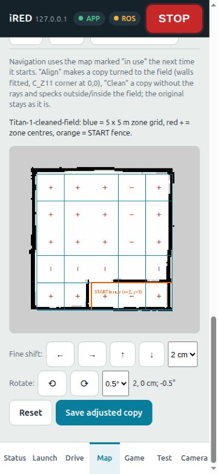

# Map fine rotation — PC only, 2026-10-22

ทำข้อ 17.1 บน `proposal/map-fine-rotation` จาก `5008bcc`.

- ปุ่ม ⟲ / ⟳ ต่อจากปุ่มเลื่อน เลือก 0.2 / 0.5 / 1 องศา ปุ่มสูงอย่างน้อย 44 px
- หมุนรอบ (2.5, 2.5) แล้วเลื่อนตามแกนสนาม; ตามเข็ม = มุมลบ
- รวม dx/dy/dyaw ใน POST `/api/map/nudge` ครั้งเดียว ได้สำเนา `-adj` ชุดเดียว (.pgm + .yaml)
- ชื่อชนใช้ `-adj-2` เป็นต้น ต้นฉบับและ active map ไม่เปลี่ยน
- ใช้ nearest-neighbour resample; ความละเอียดแผนที่ยังเท่าเดิม จึงมีข้อจำกัดระดับเซลล์แม้เลือกมุมละเอียดได้
- พรีวิวและ save ใช้ transform เดียวกัน ปัด origin เป็น 4 ตำแหน่งเหมือน YAML ก่อนวาด
- รั้ว START สีส้มเป็นเส้นอ้างอิงอยู่นิ่ง x=2 จาก y=0..1 และ y=1 จาก x=2..5
  ไม่ถูกเขียนลง occupancy map
- Reset ล้างทั้งเลื่อนและหมุน; ผลพรีวิวเก่าที่ตอบช้าไม่ทับผลล่าสุด
- จำกัดมุมสะสม ±10° และการเลื่อน ±0.5 m; ปฏิเสธ NaN/Infinity

## Validation

`source /opt/ros/jazzy/setup.bash`, prepend `src/ired_web` to existing PYTHONPATH,
then `python3 -m pytest src/ired_web/test -q`: **18 passed**.

ครอบคลุมตำแหน่ง landmark ที่คำนวณแยกอิสระทั้ง 6 มุม, YAML yaw เดิม,
เลื่อนอย่างเดียวคงพิกเซลเดิม, สำเนาเดียว, ไม่เขียนทับต้นฉบับ, อินพุตผิด,
และ preview/save เหมือนกัน รวม origin ของแผนที่จริงที่เคยทำขอบคลาด 1 px.

Fake server HTTP integration: เลื่อน (+2,-1) cm และหมุน -0.5° ได้
`Titan-1-cleaned-field-adj` ชุดเดียว; preview PNG ก่อน/หลัง save **เหมือนกันทุก byte**.
รายละเอียด [api-and-timing.json](results/api-and-timing.json).

ตรวจจริงในเบราว์เซอร์: เลือกทุก step และหมุนกลับ, Reset ปิดปุ่ม save,
เลื่อน+หมุน+save และชื่อสำเนาไม่ชน; console ของแท็บสุดท้ายไม่มี error/warning.
ตรวจ viewport 375×812, 812×375 และ 1280×900; ปุ่มใหม่กดได้และสูง 44 px.
แนวนอนพบ overflow เดิมจาก joystick `#pad-turn-m` ~22 px (ไม่ใช่ปุ่มปรับแผนที่);
ยังไม่แก้ส่วน joystick ในงานนี้.

PC preview benchmark (Titan map, 30 calls): CPU median 7.97 ms/request,
wall median 8.48 ms, max 25.68 ms. ไม่มี worker/subscription ROS ใหม่;
คำนวณตาม request เมื่อกดปุ่ม. **ยังไม่วัด CPU บน Pi และยังไม่ทดสอบบนหุ่น**.



[Saved phone preview](results/saved-portrait.png) · [Landscape](results/landscape.png) · [Desktop](results/desktop.png)

## Reproduce

```bash
source /opt/ros/jazzy/setup.bash
python3 tools/web_test/fake_server.py 8091
```

เปิด `http://127.0.0.1:8091`; ใช้ข้อมูลปลอมสำหรับ Unlock.
Fake server ใช้ MapStore จริงกับสำเนาแผนที่ใน temporary directory ไม่เขียนแผนที่ต้นฉบับ.
หยุด server หลังเทสแล้ว. ไม่ได้ SSH/push/build/restart เว็บบนหุ่น; ต้องขอผู้ใช้ก่อนทุกครั้ง.
